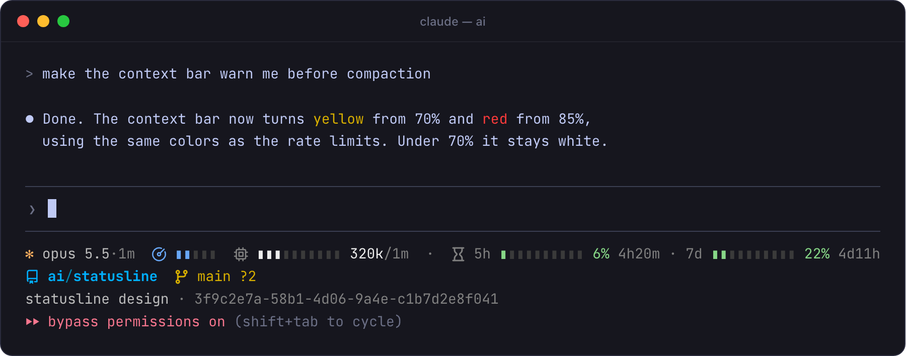
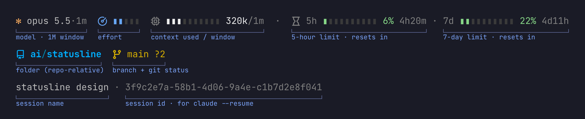

# Statusline

A three-line [Claude Code](https://code.claude.com) statusline. Every color means something, and a segment only appears when it has something to say.



## What each part shows



**Line 1, Claude.** From left to right:

- **Model**, with `·1m` when you're on the 1M-token context window.
- **Effort meter**: low → max. It gets bluer and more vivid as effort, and token use, goes up.
- **Context used**: white fill out of the window, with `used/total` tokens. Less is better. Turns yellow from 70% and red from 85%, as compaction gets close.
- **Rate limits**: one bar each for the 5-hour and 7-day limits, with % used and time until reset.
  - Green while you're within budget.
  - Yellow when you're spending faster than time passes, or above 70%.
  - Red above 90%.

**Line 2, the workspace.**

- **Folder**. Inside a git repo it's shown relative to the repo root. Long paths are shortened only when they don't fit.
- **Git branch**, in p10k-style notation: `⇡` ahead, `⇣` behind, `+` staged, `!` modified, `?` untracked, `~` conflicts.
  - Green when clean, yellow with changes, red on conflicts.

**Line 3, the session.** Its name (if you've named it), then the full session ID in dim grey, ready to copy for `claude --resume <id>`.

## Requirements

- A [Nerd Font](https://www.nerdfonts.com) (v3) and a truecolor terminal (Ghostty, iTerm2, WezTerm, Kitty…)
- `bash` 3.2+, `jq`, `git`
- Works on macOS and Linux

## Install

**Quick:** download the script.

```sh
curl -fsSL https://raw.githubusercontent.com/selrond/ai/main/statusline/statusline.sh -o ~/.claude/statusline.sh && chmod +x ~/.claude/statusline.sh
```

**With updates:** clone the repo and symlink the script, so a `git pull` updates it.

```sh
git clone https://github.com/selrond/ai
ln -s "$PWD/ai/statusline/statusline.sh" ~/.claude/statusline.sh
```

Either way, add this to `~/.claude/settings.json`:

```json
"statusLine": {
  "type": "command",
  "command": "~/.claude/statusline.sh",
  "padding": 0,
  "refreshInterval": 10
}
```

`refreshInterval` keeps the reset countdowns ticking while Claude is idle.

## Customize

All settings are variables near the top of `statusline.sh`:

| Variable | Default | What it does |
|---|---|---|
| `CTX_WARN` / `CTX_CRIT` | 70 / 85 | % of context at which the context bar turns yellow / red |
| `LIMIT_WARN` / `LIMIT_CRIT` | 70 / 90 | % at which a rate limit turns yellow / red |
| `PACE_AHEAD` | 10 | how many points ahead of elapsed time counts as "spending too fast" |
| `DIR_MAX` | 60 | path length before parent folders get shortened |
| `GIT_TTL` | 3 | seconds to reuse cached `git status` |
| `EFFORT_RGB` | blue → violet | effort meter colors, low to max |
| `BAR_EMPTY` | 237 | color of empty bar segments |
| `ICON_GAP` | one space | gap after each icon (widen it if your font draws icons wide) |
